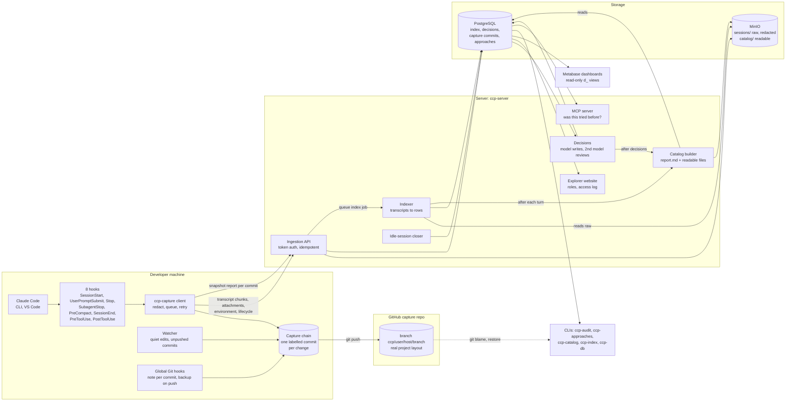
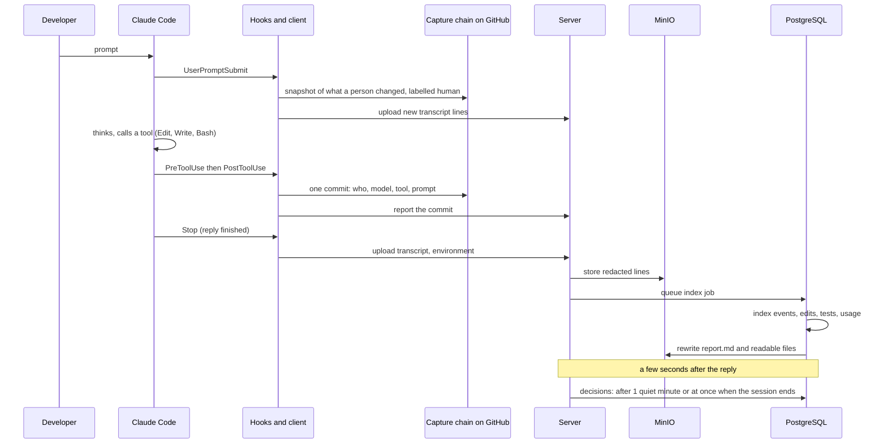

# CCP: architecture and status

The Claude Capture Platform (CCP) records every Claude Code session on developer machines (the conversation, Claude's
reasoning, the code at every step, who changed what and why), stores it, and builds an audit trail, a decision log, an
approach library and dashboards on top.

Status as of **2026-11-16**. "Done" means built and tested. "Live" means also seen working in a real Claude Code session.
The detailed, maintained list is [docs/requirements.md](docs/requirements.md); this page is the overview.

---

## 0. Setting it up

`./run.sh` on a fresh clone sets up everything (tools check, `.env` with random passwords, PostgreSQL, MinIO, Metabase,
migrations, the CCP server as a service, the dashboard, the first Explorer admin, and capture in Claude Code: hooks,
thinking summaries, the GitHub capture repo with an SSH key, the watcher and the Git hooks). `./run.sh status` and
`./run.sh stop` show and stop it.

Words used: Claude **account** → **project** → **session** (one Claude Code session, one transcript) → **chat**
(everything said in it) → **conversations** (one prompt and everything Claude did in answer).

## 1. Architecture

### 1.1 The whole picture

### 1.2 Three layers of data (nothing is guessed from a lower layer)

| Layer | Where | Rule |
| --- | --- | --- |
| 1. Raw | MinIO `sessions/<chat>/...`, GitHub capture repo | Complete, redacted on the developer machine before upload, never rewritten |
| 2. Index | PostgreSQL (migrations 001 to 023) | Rebuildable from layer 1 at any time (`ccp-index rebuild`) |
| 3. Knowledge | decisions, approaches, `report.md`, Explorer, MCP | Derived, each item linked to its evidence; a person can override |

### 1.3 What happens in one turn

### 1.4 What lives where

| Data | Stored in | Read with |
| --- | --- | --- |
| Conversation, thinking, tool calls (redacted, byte-exact) | MinIO `sessions/` | catalog, `report.md` |
| One readable file per session | MinIO `catalog/accounts/<account>/projects/<project>/sessions/<session>/report.md` (also 00 to 08 files) | Explorer download, `ccp-catalog export` |
| Code at every step, who changed it, why | GitHub capture repo branch `ccp/<user>/<host>/<branch>` | GitHub (history, blame), `ccp-audit trace` |
| Events, file changes, tests, usage, sessions, environment | PostgreSQL | Explorer, `ccp-audit`, Metabase |
| Decisions (goal, options, choice, reason, who decided, who reviewed) | PostgreSQL `decision` | Explorer, `report.md`, `ccp-approaches` |
| Capture commits linked to chat, prompt, tool call, model | PostgreSQL `shadow_commit` | `ccp-audit snapshots`, Explorer "Changes by cause" |
| Approaches (decision with its code, lineage, reuse) | PostgreSQL | Explorer, `ccp-approaches`, `ccp-mcp` |

---

## 2. Requirements: done, partial, not done

The 21 requirements come from the demo scope (R1 to R9) and from the review (R10 to R17), plus items added later.

### 2.1 Done

| # | Requirement | How |
| --- | --- | --- |
| 1 | Session start and end through hooks | Eight hooks; each opening is a session; ends are corrected from the transcript. Live. |
| 2 | Full chat transcript | Redacted, byte-exact, in MinIO. Live. |
| 3 | File changes incl. uncommitted and transient, into a shadow Git | The capture chain: one labelled commit per change, plus a watcher for quiet edits. Live (headless CLI). |
| 4 | Deployable through settings.json and scripts | `ccp-capture install`, `watch-service install`, `git-hooks install`. |
| 6 | Capture events beyond start and end | Eight hooks, incl. before and after every file-changing tool call. Live. |
| 7 | Extraction tool: sessions, commits, files | Indexer, `ccp-audit`, Explorer, Metabase. |
| 8 | Export a session to Markdown | `report.md` per chat, rewritten after every turn; command; Explorer download. |
| 10 | Forward trace: chat to code change | `ccp-audit snapshots`, Explorer "Changes by cause". |
| 11 | Reverse trace: line to conversation | `ccp-audit trace` (git blame on the chain, then prompt, thinking, decisions). Decision taken: the chain is the primary method, hunk matching stays for older chats, a Git note links each developer commit. |
| 12 | Shadow repo mirrors the original file layout | The chain is a normal branch holding the real tree. Live. |
| 18 | Postgres as structured store, shadow Git as raw layer | Migrations 001 to 023. |
| 20 | Per-session identity: Claude Code version, account | `session_env`, `claude_account`. |
| + | Approach library: search, compare, restore, lineage, MCP | `ccp-approaches`, Explorer pages, `ccp-mcp`. |
| + | Dashboards incl. who changed the code | Metabase, 29 cards, no query errors on real data. |
| + | Decisions with a second reviewing model, human override | Written by one model, reviewed by another; a person can approve or reject. |

### 2.2 Partly done

| # | Requirement | Done | Missing |
| --- | --- | --- | --- |
| 5 | Works on CLI, desktop app, VS Code | Transcript capture seen on the CLI and in VS Code; the new tool hooks run live on the Linux CLI | Desktop app, JetBrains, Windows and macOS not tested with the new hooks |
| 9 | Automated export and push to the knowledge base | The export is automatic and stored in MinIO | Nothing pushes it into a separate knowledge base (the later "knowledge" step) |
| 13 | Claude's reasoning and self-steering, incl. memory | Thinking summaries captured (the install turns on `showThinkingSummaries`) | Plans, todo lists, and memory or CLAUDE.md content that steered Claude are not captured as such |
| 14 | Test loop: generated, run, outcomes, how results steered the next code | Test runs, outcomes, cases, tests added per edit, failed-then-fixed links, manual checks against a local service | Tests that already existed are not told apart from generated ones; no semantic "why this fix" beyond the thinking |
| 15 | Change attribution: user review, Claude self-review, test; human vs AI; AI via command | Every change is `human`, `ai_edit`, `ai_command` or `subagent`, with the model; corrections record test, Claude and developer drivers | The cause is not stored on every change (only on corrections and decisions) |
| 16 | Multi-agent capture: personas and delegation | Sub-agent runs, instructions, results, workflows, and changes made by a sub-agent | Named personas (coder, tester, reviewer, security auditor) are not a concept yet |
| 19 | Session lifecycle: creation, compaction, linking, memory | Start, resume, clear, compact, end, idle, and gaps inferred from the transcript | Linking separate chats of one piece of work; memory |
| 21 | Per-session environment | OS, surface, shell, entrypoint, remote or local | `run_mode` (interactive, headless, SDK); surface and access path are inferred |

### 2.3 Not done

| # | Requirement | Note |
| --- | --- | --- |
| 17 | Per-persona memory that human master reviewers can review and influence | Later phase; depends on personas. The Review page and decision overrides exist for decisions. |
| - | Private mode (a switch that sends only a minimal record) | On hold by decision (task 1.9b) |
| - | Retention periods and a delete-a-chat job | Planned for the move to a server. There is no way yet to remove one chat from storage. |
| - | HTTPS and sign-in for the dashboards, restricting `session_env` | Planned for the move to a server |
| - | Knowledge step: distilled entries, semantic search (pgvector) | Later step; keyword search exists |

---

## 3. What is built (summary of components)

| Component | What it does | Where |
| --- | --- | --- |
| Capture client | Hooks, redaction, upload with offline queue, environment record | `src/ccp/capture/` |
| Capture chain | One labelled commit per change, pushed to GitHub, reported to the server | `src/ccp/capture/snapshots/` |
| Watcher and Git hooks | Quiet edits, unpushed commits, a note per commit | `watcher.py`, `githooks.py`, `watch_service.py` |
| Ingestion API | Token-authenticated, idempotent uploads | `src/ccp/ingest/` |
| Indexer | Transcripts to events, edits (incl. shell-written files), tests, usage, sessions | `src/ccp/index/` |
| Catalog and report | Readable folder per chat and the single `report.md` | `src/ccp/catalog/` |
| Decisions | Model writes, a different model reviews, a person can override | `src/ccp/decisions/` |
| Audit | Exact line tracing, history, commit linking | `src/ccp/audit/` |
| Approaches | Lineage, search, compare, restore | `src/ccp/approaches/` |
| Explorer | Website with roles; approaches, timeline, review, activity, insights, alerts | `src/ccp/explorer/` |
| MCP server | Claude asks "was this tried before?" | `src/ccp/mcp/` |
| Dashboards | Metabase as code, read-only views | `src/ccp/dashboards/` |

---

## 4. Open items and honest limits

1. **Uncommitted work.** On branch `feat/chat-hierarchy` only the first report commits are committed; most of the later work
   (capture chain, tracing, approaches, Explorer pages, watcher, MCP, fixes) is uncommitted and waits for an instruction.
2. **Restart after upgrades.** `ccp-server` must be restarted to run new code: `./run.sh` does it.
3. **GitHub access.** The capture repo receives data through a deploy key with write access; each developer machine needs its
   own key or token.
4. **Tests.** The last full run was 1,791 passed, 0 failed; changes made after it (snapshot secret check, faster decisions)
   were tested in their areas, but the whole suite has not been re-run since.
5. **Not tried live.** Desktop app, JetBrains, Windows and macOS; the Git hooks and the watcher were tested in scripted
   tests, not yet left running for a week (the self-pilot, task 1.12).
6. **Limits of the data.** Thinking is Claude's summarised reasoning, not proof of intent; Claude Code's own cost record is
   a lagging snapshot, so the cost in a summary can trail the last replies; a file changed by a `python` script inside a
   shell command is recorded exactly by the capture chain but only partly by the transcript-based rows.
7. **Security.** Secrets are redacted on the developer machine by pattern; a value no pattern recognises (for example a
   password typed into a chat) is not caught. Do not paste secrets into a captured chat. Snapshots leave out files that
   contain secret-looking values (about 14 of 375 in this repository, mostly test fixtures).

---

## 5. Where to read more

| Topic | Document |
| --- | --- |
| Requirement-by-requirement status | [docs/requirements.md](docs/requirements.md) |
| How to run it | [docs/quickstart.md](docs/quickstart.md) |
| The capture chain, watcher, Git hooks | [docs/snapshots.md](docs/snapshots.md) |
| Hooks | [docs/hooks.md](docs/hooks.md) |
| The report and the catalog | [docs/catalog.md](docs/catalog.md) |
| Decisions | [docs/decisions.md](docs/decisions.md) |
| Exact tracing | [docs/audit.md](docs/audit.md) |
| Approach library and MCP | [docs/approaches.md](docs/approaches.md), [docs/mcp.md](docs/mcp.md) |
| Explorer | [docs/explorer.md](docs/explorer.md) |
| Dashboards | [docs/dashboards.md](docs/dashboards.md) |
